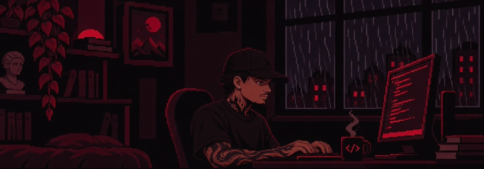

# hey, i'm oliver!

**computer science student @ UFAL · brazil**

*building things, breaking them, figuring out why.*

## about me

i'm a computer science student at the **Federal University of Alagoas (UFAL)**, also studying systems analysis and development at Anhanguera.

interested in web development and software engineering, with a focus on building applications and understanding how things work.

## tech & tools

## education

- **computer science** — Federal University of Alagoas (UFAL)
- **systems analysis & development** — Anhanguera
